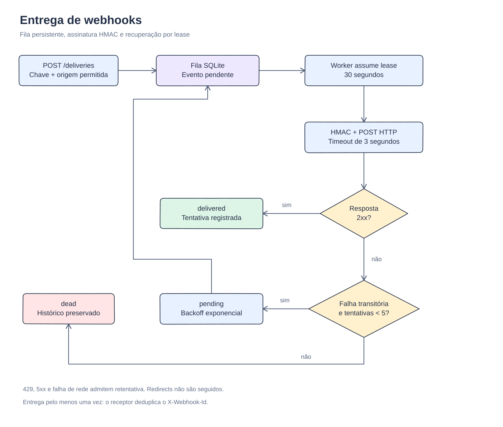

# Webhook Relay

Entrega assinada de eventos com retentativas e recuperação.


[Executar localmente](#executar-localmente) · [Fluxo](#fluxo-principal) · [Estrutura](#estrutura-do-código) · [OpenAPI](docs/openapi.json)

Fila persistente de webhooks em NestJS. Recebe um evento, entrega uma requisição assinada e mantém o histórico de tentativas para que o integrador consiga investigar falhas.

| Interface          | Persistência                | Verificação                       |
| ------------------ | --------------------------- | --------------------------------- |
| API REST e Swagger | SQLite com WAL e transações | 7 testes HTTP + TypeScript strict |

## Fluxo principal



[Editar no Excalidraw](docs/diagrams/flow.excalidraw) · [Abrir SVG](docs/diagrams/flow.svg) · [Versão PNG](docs/diagrams/flow.png)

Para editar, baixe o arquivo `.excalidraw` e abra-o em [excalidraw.com](https://excalidraw.com).

## Entrega e recuperação

- A criação é idempotente pela chave do cliente e pelo conteúdo serializado do evento.
- O worker roda a cada segundo, retira até dez eventos por ciclo e reserva cada trabalho com um lease de 30 segundos.
- A chamada HTTP tem timeout de três segundos. O backoff é de 1, 2, 4 e 8 segundos antes de atingir cinco tentativas e marcar `dead`.
- 429, 5xx e falhas de rede podem ser repetidos. Outros status, inclusive redirects, são terminais.
- O cliente pode reprocessar uma entrega `dead`, abrindo outra geração e preservando o histórico anterior.
- Após um crash, o lease pode ser retomado. Um token de lease impede que uma execução antiga confirme um trabalho assumido por outro worker.
- Um evento na quinta tentativa que perdeu seu lease vai para `dead` na próxima varredura. A tentativa abandonada permanece com status `started`, o que distingue uma interrupção de uma resposta HTTP recebida.

## Executar localmente

Requer Node.js 24+ e npm. O SQLite usa o módulo nativo do Node, sem instalação de banco ou chave de serviço externo.

```powershell
npm ci
npm run setup
npm run build
npm start
```

O comando `setup` cria um `.env` com segredos aleatórios e preserva um arquivo já existente. O arquivo é ignorado pelo Git. Na janela de outro terminal, rode `npm run demo` para executar um fluxo completo contra a API já iniciada.

- `GET /health` verifica se o processo está disponível.
- `/docs` abre o Swagger interativo.
- `/docs-json` expõe o contrato OpenAPI.
- `npm test` compila e executa testes HTTP reais com bancos temporários.
- `npm run format:check` verifica o padrão Prettier.
- `npm run dev` observa o JavaScript compilado. Rode `npx tsc --watch` em outro terminal para recompilar TypeScript durante o desenvolvimento.

## Docker

Depois de `npm run setup`:

```powershell
docker compose up --build
```

O container roda como usuário `node`, com volume de dados e porta publicada somente no loopback do host. O Dockerfile usa etapas de build e runtime. Os testes locais foram executados no Node 24 do Windows; a execução Docker depende de um daemon disponível.

## Endereços e configuração

A API usa **4312** e o receptor da demonstração usa **4399**. Abra **http://localhost:4312/docs** e autorize com `API_KEY`.

`ALLOWED_WEBHOOK_ORIGINS` é uma lista de origens exatas separadas por vírgula. O padrão do exemplo é `http://127.0.0.1:4399`. O remetente revalida o destino no momento da entrega, rejeita credenciais na URL, exige HTTPS para hosts externos e não segue redirects. A lista deve conter somente receptores confiáveis. Ela não substitui controles de egress e resolução DNS em uma infraestrutura pública.

O comando `npm run demo` abre um receptor local, valida a assinatura e imprime o resultado persistido. No Docker, `127.0.0.1` dentro do container é o próprio container: ajuste o destino/origem para um receptor acessível e confiável nesse ambiente. A demonstração padrão foi escrita para execução local.

| Método | Rota                  | Finalidade                           |
| ------ | --------------------- | ------------------------------------ |
| POST   | /deliveries           | Enfileira evento com Idempotency-Key |
| GET    | /deliveries/:id       | Consulta estado e tentativas         |
| POST   | /deliveries/dispatch  | Processa até dez eventos prontos     |
| POST   | /deliveries/:id/retry | Abre nova geração para evento dead   |

Todos os endpoints acima exigem `X-Api-Key`. `WORKER_ENABLED=false` desativa o processamento periódico para testes ou inspeção; o endpoint de dispatch continua disponível.

## Contrato de assinatura

Headers enviados:

```text
X-Webhook-Id: identificador estável da entrega
X-Webhook-Timestamp: segundos Unix da tentativa
X-Webhook-Signature: v1=<HMAC SHA-256 hexadecimal>
```

O conteúdo assinado é `timestamp + "." + deliveryId + "." + corpoJSONOriginal`, com `WEBHOOK_SECRET`. O receptor deve validar os bytes originais antes de desserializar, usar comparação de tempo constante e impor uma janela de timestamp. A demonstração valida o HMAC; um receptor real deve também controlar replay e deduplicar o identificador.

O modelo é **pelo menos uma vez**. Se o receptor aceitou e o remetente caiu antes de registrar o sucesso, uma tentativa posterior pode repetir o mesmo evento. A assinatura autentica a mensagem, mas a deduplicação é responsabilidade do receptor. A idempotência de criação compara JSON serializado; a ordem das propriedades participa da comparação.

## Testes e limites

Sete cenários HTTP cobrem destino bloqueado, validação/autenticação, assinatura real, replay, backoff e fila de falhas, reprocessamento, respostas 400/302, recuperação de lease, disputa entre dispatches e persistência após reinício.

A fila usa um arquivo SQLite local e funciona sem Redis ou serviço externo. O histórico e os payloads são persistidos sem criptografia de aplicação: retenção, criptografia em repouso e gestão de segredos são decisões de implantação. A API não fornece transformação de payloads, cadastro multiempresa ou garantias de entrega exatamente uma vez.

## Estrutura do código

```text
src/
  app.ts                     Bootstrap, validação global e Swagger
  app.module.ts              Composição dos módulos
  health/
    health.controller.ts
  database/
    database.module.ts
    database.service.ts      Conexão e transações SQLite
  deliveries/
    deliveries.module.ts
    deliveries.controller.ts   Entrada HTTP e delegação
    deliveries.dto.ts          Contratos e validação
    deliveries.service.ts      Regras e fronteiras transacionais
    deliveries.schema.ts       Definição das tabelas e índices
    deliveries.types.ts        Tipos internos
  security/
    api-key.guard.ts
test/                        Testes HTTP com banco temporário
scripts/                     Configuração e demonstração
docs/                        Contrato, exemplos e diagramas
```

Controllers recebem HTTP e delegam ao serviço. DTOs validam os dados antes do domínio. Cada módulo importa o módulo de banco e declara seus próprios providers. As regras e o SQL transacional permanecem no serviço de aplicação para tornar a atomicidade explícita, sem uma camada de repositório que apenas repetiria chamadas.

A formatação é verificada com Prettier. O compilador usa `strict`, `noUnusedLocals` e `noUnusedParameters`. O template em [docs/ci-template.yml](docs/ci-template.yml) instala as dependências pelo lockfile, verifica a formatação e executa os testes. Ele pode ser colocado em `.github/workflows/ci.yml` por uma credencial com permissão de workflows. A verificação deste projeto foi executada localmente.

## Evidências locais

- [Contrato OpenAPI exportado da aplicação](docs/openapi.json)
- [Resposta obtida ao executar a demonstração](docs/demo-response.json)

Os identificadores e horários no exemplo são de uma execução local. O fluxo pode ser repetido com o comando de demonstração. O Docker Desktop estava sem daemon na verificação local; apenas a configuração Compose foi validada.
